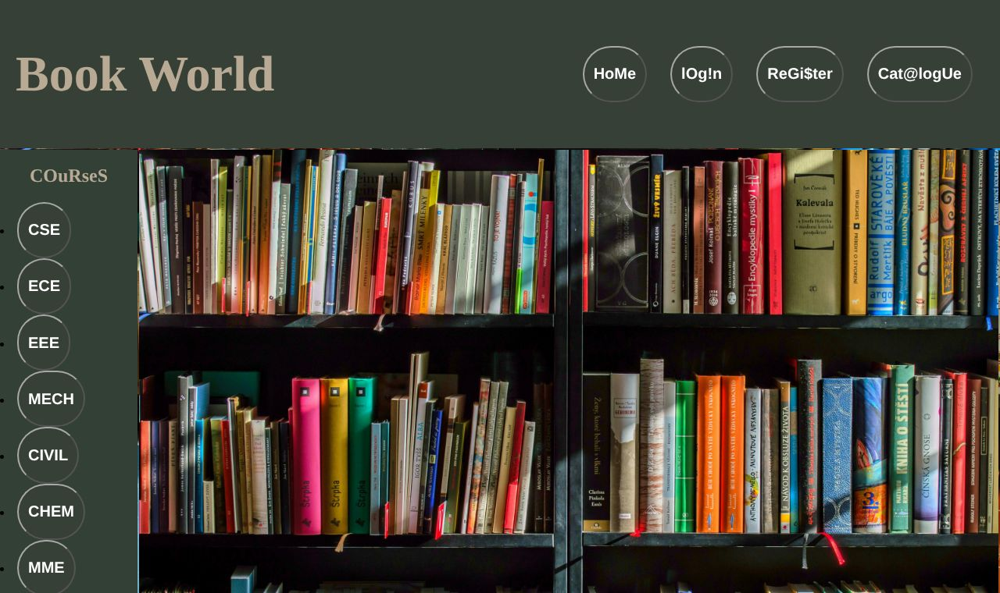
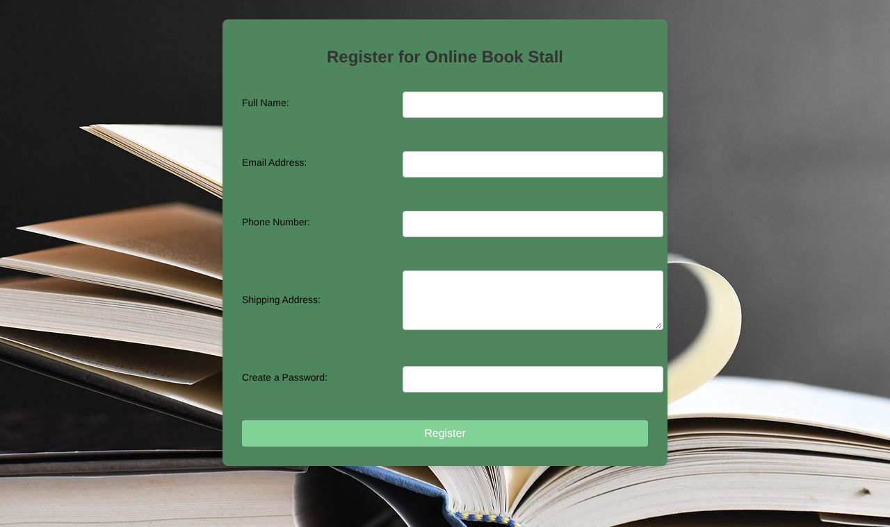

<div align="center">

# 📚 BookHive (Book World)

### Online bookstore website: Web Technologies project




</div>

## Overview

A multi-page bookstore website built with plain HTML, CSS and JavaScript, with a **PHP + MySQL** back end for user registration and login. Visitors can browse a catalogue of novels and fiction, see textbooks for each engineering branch (CSE, ECE, EEE, Mech, Civil, Chem, MME), and create an account.

## Features

- **Single-page style navigation:** a fixed header and course sidebar load each page into a content frame
- **Book catalogue:** card grid with cover images and prices, grouped by genre
- **Branch-wise textbook pages** for 7 engineering departments
- **Registration (PHP + MySQL):** server-side validation, passwords hashed with `password_hash()`, inserts through **prepared statements**
- **Login (PHP + MySQL):** `password_verify()` check and a PHP session on success
- **Client-side form validation** in JavaScript on the login and registration forms

## Screenshots

| Catalogue | Registration |
|---|---|
|  |  |

## Run locally (XAMPP)

1. Install [XAMPP](https://www.apachefriends.org/) and start **Apache** and **MySQL**.
2. Clone into `htdocs`:
   ```bash
   cd /opt/lampp/htdocs            # Windows: C:\xampp\htdocs
   git clone https://github.com/sreeja-dende/Book-Stall.git
   ```
3. Create the database: open http://localhost/phpmyadmin and run [`schema.sql`](schema.sql).
4. If your MySQL root user has a password, set it in [`db.php`](db.php) (or set the `DB_PASS` environment variable).
5. Open http://localhost/Book-Stall/main_page.html

## Project structure

```
main_page.html        # Shell: header, course sidebar, content frame
main_page.css
home/                 # Landing page
catalogue/            # Book catalogue
courses/              # Textbooks per engineering branch
register/             # Registration form + register.php
login/                # Login form + login.php
db.php                # Shared MySQL connection (reads DB_* env vars)
schema.sql            # Table for registered users
Images/               # Book covers and backgrounds
```

## Roadmap

- [ ] Persistent cart and checkout (the Buy and Cart buttons are UI-only for now)
- [ ] Load the catalogue from MySQL instead of static HTML
- [ ] Order history for logged-in users
